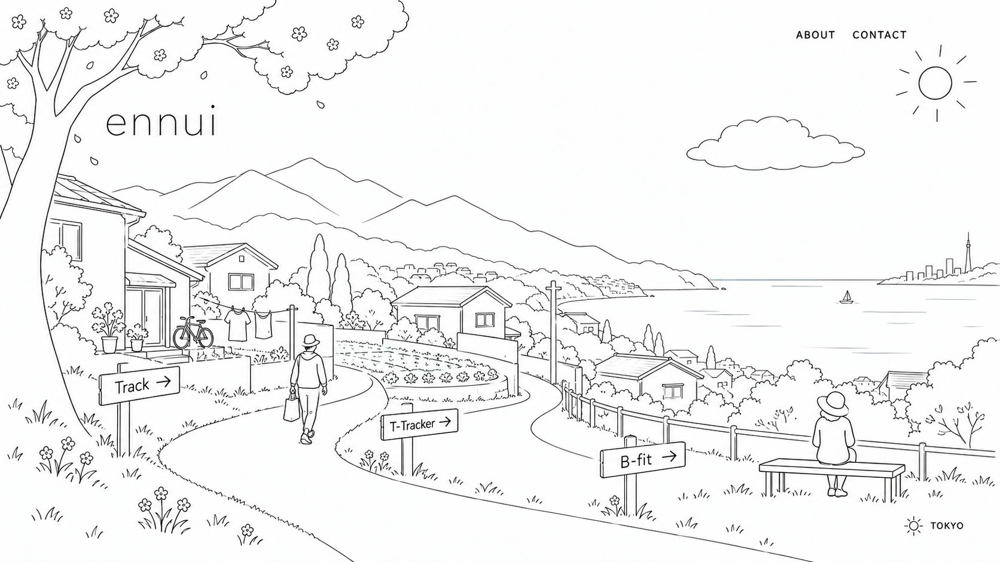
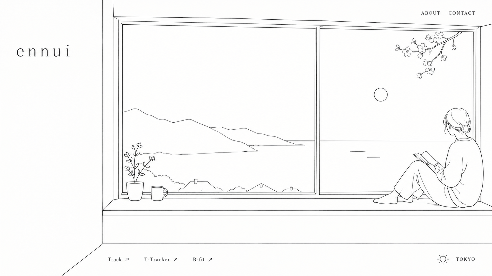

# ennui デザイン案

A案・B案を同時に検討する。現時点ではどちらかに絞らず、各案を独立して更新する。

## 共通条件

- 屋号予定は小文字の「ennui」。TAKUYA SAEKI / PORTFOLIO は表示しない。
- 初期ラフは余白の多いモノクロ線画。輪郭中心で、陰影や細かな描き込みを抑える。
- スクロールなしの1画面を基本とする。
- 各案の構図を固定し、その中で四季・時間帯・天候の移り変わりを表現する。
- 東京を基準とした実際の日時・天気・気温・風との連動を想定する。
- 日中は必ず1人以上の人間が見える。
- 実績は Track / T-Tracker / B-fit。リンクの配置は案ごとに検討する。
- スマホ向けの構図は各案とも未検証。

## A案：海を望む集落

屋外の小道から、山・集落・遠くの海を見渡す。田畑は小さく抑え、軒先・自転車・洗濯物・庭などで暮らしの気配を表現する。
人物は買い物帰りの人とベンチで過ごす人。実績リンクは道沿いの看板として配置する。
四季は木・草花・菜園・人物の服装で表す。最新構図での四季差分は未作成。

## B案：窓辺から眺める山と海

家の室内から大きな窓越しに山と海を眺める。情報量を抑え、本を読む人・カップ・鉢植えで暮らしを表現する。
人物は窓辺に配置し、実績リンクは画面下部にまとめる。
四季は窓の外の枝・景色・人物の服装で表す。天候や時間帯は空模様や光で表現する想定。四季差分は未作成。

## 今後の扱い

- 「A案を調整」「B案を調整」と案名を指定して進められる。
- 共通条件の変更は両案に反映する。
- ラフの更新は別バージョンとして保存し、比較できるようにする。
- 画像生成には組み込みの画像生成ツールを使用。上記の各案の説明と共通条件を再生成・編集時の基準とする。
