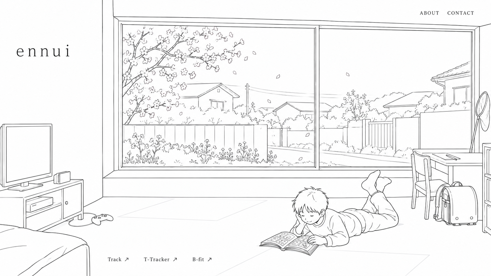
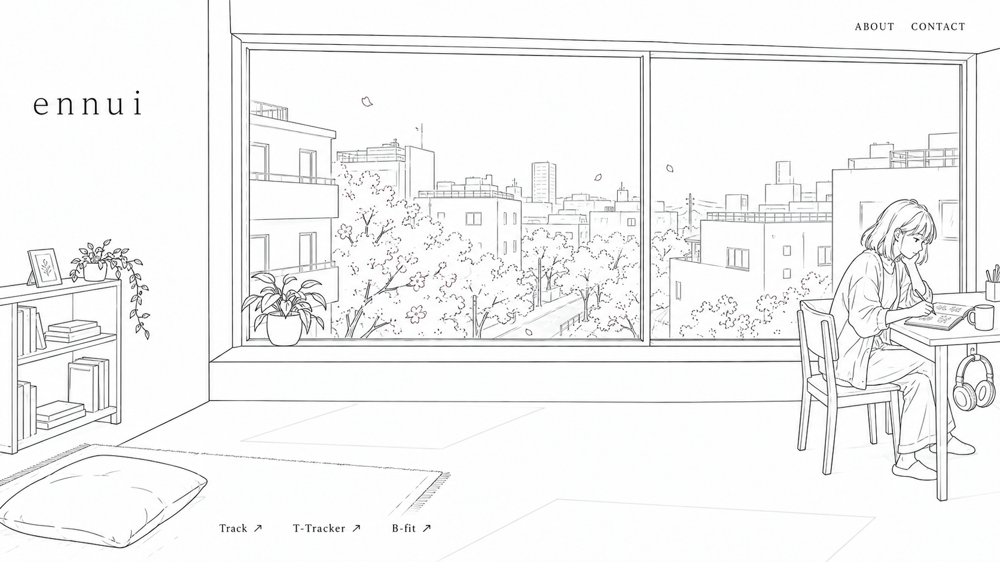
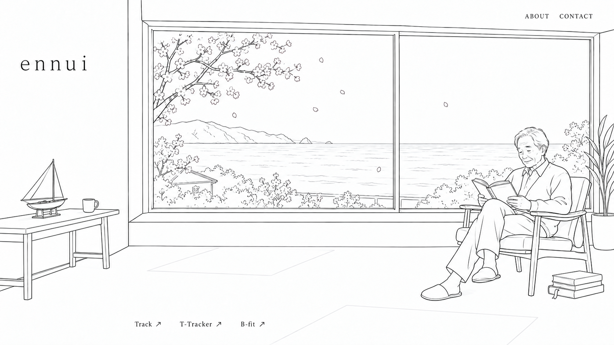

# B案 春の人物別ラフ

2026-09-19時点のNotion人物設定を参照。組み込み画像生成ツールを使用。

- 縁：小学4年生の男の子。東京都下の庭と通り。床で漫画を読む。
- 凜：20代半ば、肩口の髪。5階から街を見下ろす部屋でスケッチ。
- 卓：60代後半の男性。海の見える低層の部屋で、木肘の一人用チェアに座り読書。

共通の窓・間取りを基準に、春の日中をモノクロ線画で描いた構図検討用の画像。太陽・月・天気アイコンは表示しない。人物全員の日中在室を反映。
生成ラフのため窓形状の厳密な座標一致は未保証。実装時は共通レイアウトを使用する。卓の小舟模型は種類未定のため仮表現。







## 生成プロンプト

### Enishi

```text
Use case: ui-mockup. Create ONE wide 16:9 standalone illustration rough for the ennui portfolio website, using reference as STYLE AND COMMON ROOM GEOMETRY guide. Pure monochrome sparse thin pencil contour lines on white, no color, no gray fills, no hatching, no dense textures. Preserve common camera and identical architectural geometry in this series: left blank wall about 22% width, large rectangular two-pane window from x24% to96%, top y10%, sill y67%, foreground floor below. Enough foreground floor to show furniture and seated person, never truncate human. lowercase 'ennui' upper left on blank wall, tiny 'ABOUT   CONTACT' upper right, bottom links 'Track ↗   T-Tracker ↗   B-fit ↗'. No other text. NO SUN OR MOON DISC, NO WEATHER ICONS. Spring daylight suggested by open white space and just two very light outline shapes of window-cast light on floor, no shading. Keep indoor/outdoor separation coherent, cherry petals OUTSIDE glass only. One clearly visible human indoors. Same room floor plan and window size/location for all 3 people, only furnishing and OUTSIDE elevation/view change. Personality comes from pose and few simple identifiable objects, not clutter. Scene 1 ENISHI: ordinary lively Japanese fourth-grade schoolboy, short hair, casual long sleeve top and trousers, lying comfortably prone on floor reading an open manga book in lower right foreground, feet casually bent, clearly a child. View out window is LOW ground-level suburban western Tokyo near Ome/Fussa: modest garden, simple fence, quiet lane and a few low rooflines, ONE blooming cherry tree, sparse flowers, no sea or urban highrises. Indoors small TV with game console on low stand at left below window, one controller. School backpack with fresh cover dropped beside small study desk on right edge, only one homework sheet. Insect net leans against far right wall as a permanent possession, NO INSECTS, no insect-catching activity in spring. A small bookshelf and bed edge may be suggested with extremely few lines only if space allows. Keep far fewer marks than typical detailed illustration. Do not reproduce the adult woman or sea from reference. Large blank surfaces.
```

### Rin

```text
Use case: ui-mockup. Create ONE wide 16:9 standalone illustration rough for the ennui portfolio website, using reference as STYLE AND COMMON ROOM GEOMETRY guide. Pure monochrome sparse thin pencil contour lines on white, no color, no gray fills, no hatching, no dense textures. Preserve common camera and identical architectural geometry in this series: left blank wall about 22% width, large rectangular two-pane window from x24% to96%, top y10%, sill y67%, foreground floor below. Enough foreground floor to show furniture and seated person, never truncate human. lowercase 'ennui' upper left on blank wall, tiny 'ABOUT   CONTACT' upper right, bottom links 'Track ↗   T-Tracker ↗   B-fit ↗'. No other text. NO SUN OR MOON DISC, NO WEATHER ICONS. Spring daylight suggested by open white space and just two very light outline shapes of window-cast light on floor, no shading. Keep indoor/outdoor separation coherent, cherry petals OUTSIDE glass only. One clearly visible human indoors. Same room floor plan and window size/location for all 3 people, only furnishing and OUTSIDE elevation/view change. Personality comes from pose and few simple identifiable objects, not clutter. Scene 2 RIN: Japanese woman mid twenties, SHOULDER-LENGTH loose hair (not long hair or elaborate bun), light spring cardigan over casual top, seated at small desk beside window on RIGHT foreground, drawing in an open sketchbook as a personal hobby, not a professional office. One coffee mug on desk, headphones hanging on side hook, ONE potted plant on sill. Small bookshelf on left interior wall with a few books/notebooks, ONE simple rug and cushion on floor. Keep all room architecture and camera exactly as the supplied scene 1 reference, replace child, TV, bed, school backpack and insect net entirely with Rin's furniture. Outside is clearly FIFTH FLOOR elevated view looking DOWN on modest urban Tokyo rooftops, a street with sparse flowering cherry street trees seen from above, just 3 or 4 building masses with few windows. No sea, no mountains, no garden-level fence. Room shell and window position MUST remain identical to reference; outdoor perspective alone changes. Use FEWER outdoor line marks than reference, simplified cherry crowns with only few blossoms, no dense foliage. Light airy spring daytime no sun disc. Whole person and chair visible. Quiet life/art balance, plentiful white space.
```

### Suguru

```text
Use case: ui-mockup. Create ONE wide 16:9 standalone illustration rough for the ennui portfolio website, using reference as STYLE AND COMMON ROOM GEOMETRY guide. Pure monochrome sparse thin pencil contour lines on white, no color, no gray fills, no hatching, no dense textures. Preserve common camera and identical architectural geometry in this series: left blank wall about 22% width, large rectangular two-pane window from x24% to96%, top y10%, sill y67%, foreground floor below. Enough foreground floor to show furniture and seated person, never truncate human. lowercase 'ennui' upper left on blank wall, tiny 'ABOUT   CONTACT' upper right, bottom links 'Track ↗   T-Tracker ↗   B-fit ↗'. No other text. NO SUN OR MOON DISC, NO WEATHER ICONS. Spring daylight suggested by open white space and just two very light outline shapes of window-cast light on floor, no shading. Keep indoor/outdoor separation coherent, cherry petals OUTSIDE glass only. One clearly visible human indoors. Same room floor plan and window size/location for all 3 people, only furnishing and OUTSIDE elevation/view change. Personality comes from pose and few simple identifiable objects, not clutter. Scene 3 SUGURU: Japanese man late sixties, short softly swept gray/white hair indicated ONLY by white contour, no mandatory glasses, no beard needed, healthy relaxed curious demeanor, lightweight cardigan and trousers. Seated reading open book in a SINGLE midcentury Japanese wooden armchair with curved exposed wood arms and simple upholstered seat, Karimoku-like unbranded, at RIGHT foreground beside window. Whole man and chair visible. A stack of THREE books beside chair, one with clearly protruding bookmark. Small work table on left below window with ONE miniature boat model (provisional simple hobby model) and one cup. Avoid elaborate model parts. Outside is low-rise coastal home EYE LEVEL view of sea, clear horizon at mid-window, distant mountains/headland on left, no fifth-floor downward city view, no large town. A sparse blooming cherry branch visible OUTSIDE upper left window and a few petals outside, several simple water strokes. Keep IDENTICAL architectural floor plan window position size mullion and camera as reference child image. Replace child TV backpack insect net desk bed with Suguru furniture; no duplicate child or woman. Large quiet white areas. Extremely sparse linework, simpler than reference, no shading, no sun disc or weather icons. Show reflective but content everyday life not loneliness or frailty.
```

